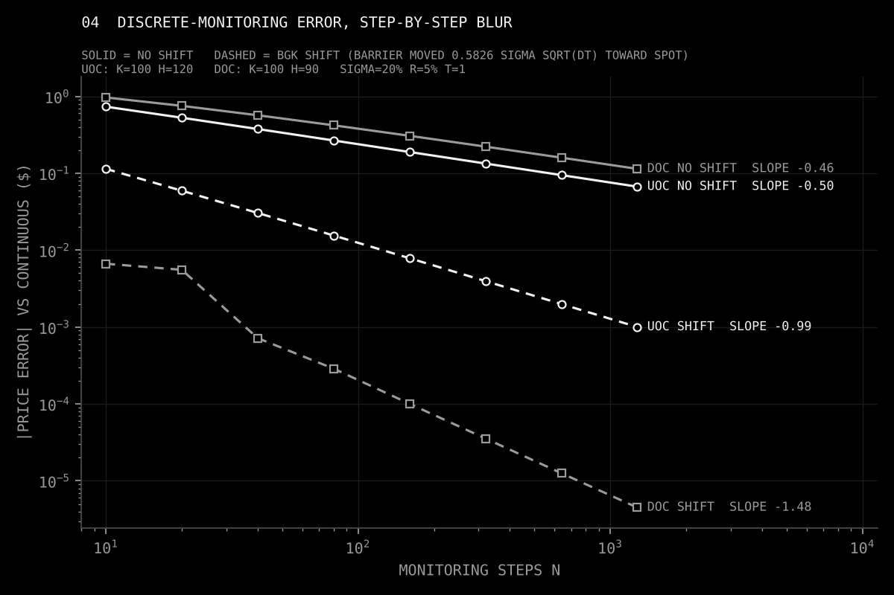
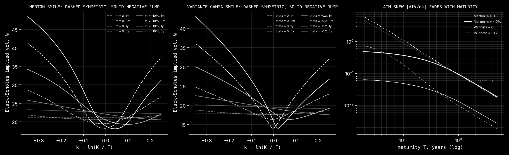
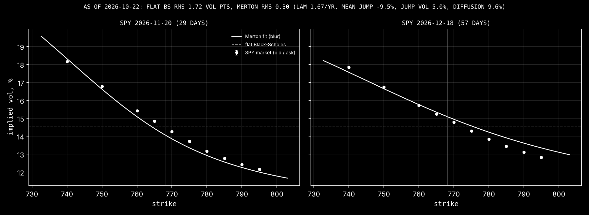
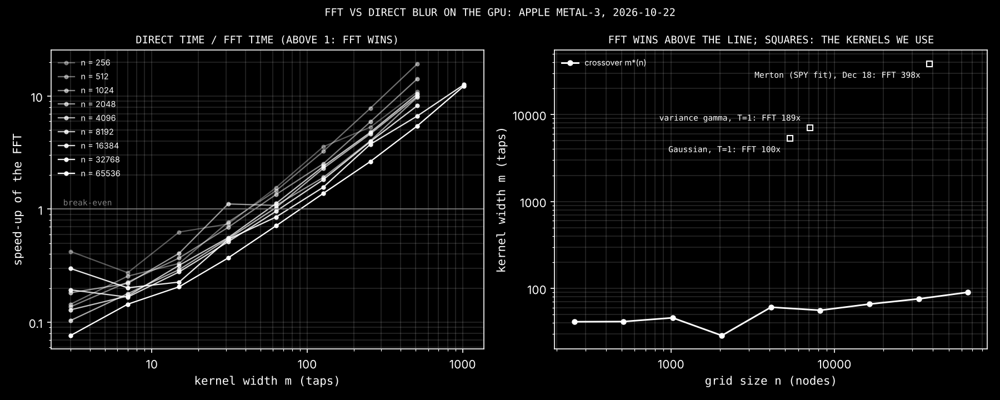
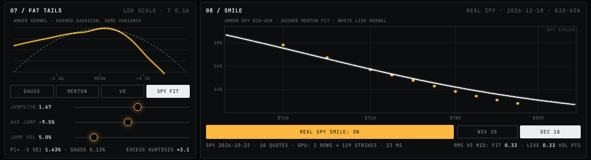
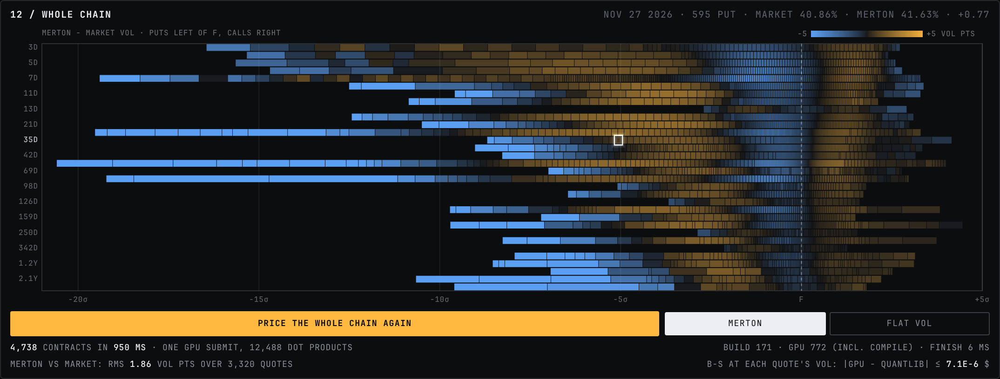

# Blur Desk

[](https://github.com/aleksanderstevens191-sudo/blur-desk/actions/workflows/checks.yml)

The blur filter in a photo app can price stock options.

An option's price is its payoff, blurred. Blurring an image and pricing an option solve the same equation (the heat equation), so the same Gaussian blur that softens a photo turns a sharp payoff into a smooth price curve.

- **Bachelier model:** a plain Gaussian blur of the payoff.
- **Black-Scholes:** the same blur in log-price, with the blur nudged slightly off-center by the interest-rate drift, then discounted.
- **American options:** blur one small time step, discount, clip to the payoff, repeat.
- **Crashes and the smile:** swap the Gaussian for a kernel with fat tails (Merton jumps, variance gamma) and the same blur prices a market that can jump. Read the prices back as Black-Scholes vols and out comes the volatility smile, fitted here to real SPY options.
- **The market's odds:** run the edge-detect kernel `[1, -2, 1]` across a row of call prices and out comes the probability distribution the market is pricing (Breeden–Litzenberger, 1978).

## Results so far (CPU reference)

All numbers come from `reference/check.py`; full output is in `reference/results.txt`.

| Check | Result |
| --- | --- |
| Black-Scholes calls, 20 options (T = 0.1 to 2 years, strikes 80 to 120) | max error **$0.000013** vs the closed form |
| Bachelier calls | error shrinks with the grid, down to $0.0000002 |
| American put (S = K = 100, σ = 20%, r = 5%, 1 year) | 6.090368 vs 6.090333 from a 20,000-step binomial tree (**$0.000035** apart) |
| Edge-detect density (3-month, strikes $0.50 apart) | max error 0.0000085 vs the true density; sums to 0.99996 |
| CPU speed, one blur over a 10,001-point grid | ~0.9M option prices/sec (numpy); this is the GPU baseline |
| JavaScript core vs Python | identical to 11 decimal places |

## Barrier options

A barrier option is a call or put that dies (knock-out) or comes alive (knock-in) the first time the stock touches a level H. There are eight single-barrier types (down or up, in or out, call or put) plus the double knock-out, which dies at either of two levels L < U. A knock-in is always the vanilla minus the knock-out, so the hard part is the knock-out.

Every number below is against the closed form for a barrier watched continuously: Reiner-Rubinstein for one barrier, which agrees with QuantLib to 5.5e-12, and the exact image series for two, which agrees with QuantLib to 1.4e-8 (a 40-digit check puts that gap on QuantLib's side).

| Method | Blurs | Error, down-and-out call K=100, H=90, σ=20%, r=5%, T=1 |
| --- | --- | --- |
| (a) plain mirror: payoff minus its reflection across H | 1 | **+$0.63** (exact only when r = σ²/2) |
| (b) weighted mirror: the reflection times (H/S)^(2ν/σ²) | 1 | **1.2e-9** |
| (c) step by step, monitored N = 25 / 100 / 400 times | N | +$0.69 / +$0.38 / +$0.20 |
| (c) plus the BGK shift, N = 25 / 100 / 400 | N | −$0.0032 / −$0.00020 / −$0.000025 |
| double knock-out, one blur of the image series (72 options) | 1 | max 5.9e-9 |

### Why the plain mirror fails

The reflection principle: for a random walk with no drift, every path that touches the barrier and ends at x has a twin, mirrored after the first touch, that ends at 2h − x (h = ln H). Subtract the payoff's mirror image and the paths that touched cancel out, which is the knock-out price.

In log price the stock drifts at ν = r − q − σ²/2, and drift breaks the symmetry: a path is more likely to go with the drift than against it, so the twin is not equally likely. Weighting the image by e^(2ν(h−x)/σ²) = (H/S)^(2ν/σ²) restores the balance. Without the weight the mirror is right only when ν = 0, that is r − q = σ²/2. At σ = 20% that means r = 2%, where the plain mirror is exact (1.2e-9); at r = 5% it is off by up to $1.59 across the eight types. With the weight, one blur prices all eight types to within 1.3e-9 of the closed form.

Two barriers make two mirrors facing each other: a hall of mirrors. The payoff is tiled across cells of width ln(U/L), alternately reflected and shifted, each with its weight, and one blur of the tiled payoff is the double knock-out price. The number of images needed for 1e-8 is about 11 × σ√T / ln(U/L).

### Why step by step overprices

The other way to price a knock-out: blur one small time step, zero everything past the barrier, repeat. That checks the barrier only on the N monitoring dates. A path can cross the barrier and come back between two dates and the method never sees it, so too few paths die. Every knock-out comes out too high and every knock-in too low (table above), and the gap shrinks only like 1/√N, because a path can wander about σ√dt past the barrier between checks.

### What the shift fixes

Broadie, Glasserman and Kou (1997) showed that a barrier checked on N dates behaves like a continuous barrier moved away from the spot by β σ√dt, with β = −ζ(1/2)/√(2π) ≈ 0.5826. Run that backwards: to get the continuous price out of the step-by-step blur, check a barrier moved toward the spot by 0.5826 σ√dt. The shift cancels the 1/√N term. What is left falls like 1/N when the payoff is still worth something at the barrier (up-and-out call, K < H) and like N^(−3/2) when it is zero there (down-and-out call, K > H):

| Error vs continuous, σ=20%, r=5%, T=1 | slope, no shift | slope, BGK shift | N = 1280, no shift | N = 1280, BGK shift |
| --- | --- | --- | --- | --- |
| up-and-out call K=100, H=120 | −0.50 | −0.99 | $0.067 | $0.0010 |
| down-and-out call K=100, H=90 | −0.46 | −1.48 | $0.11 | $0.0000045 |



### On the GPU

- All three methods run as WebGPU compute shaders (`src/gpu.js`). `src/barrier.js` is the same code in 64-bit JavaScript and matches Python to about 1e-12 (`node src/test-barriers.mjs`).
- `/check.html` runs 26 barrier fixtures from `reference/make_barrier_fixtures.py` on the GPU in 32-bit floats: worst |gpu − Python| is 1.8e-6 (tolerance 1e-4).
- `/bench.html` prices all 8 types × 32 barriers × 64 strikes = 16,384 options in one dispatch. On an Apple GPU the worst error is 9.3e-6 against the closed form. Both sides measured on the same Mac in one session (`reference/gpu_barrier_bench_mac.txt`, `reference/bench_quantlib_mac.txt`):

  | Same 16,384 barrier options, same Mac | options/sec |
  | --- | --- |
  | Apple GPU (Metal-3, WebGPU in Chrome), one dispatch, submit to done, 2.10 ms (median of 20) | **7.8 million** |
  | QuantLib 1.44 `AnalyticBarrierEngine`, 1 CPU thread, repricing after a bump, 25.2 ms | 651,000 |
  | QuantLib, building the instruments and pricing them, 85.2 ms | 192,000 |
  | the same blur in plain JavaScript, 1 CPU thread | 38,800 |

  That is 12 times QuantLib's closed form on the same machine, or 41 times if QuantLib also has to build its instruments. An earlier version of this README said about 34 times: it divided an earlier Mac GPU run (10.2 million a second) by QuantLib on a different machine (a 2.8 GHz Xeon, 305,000 a second). Browser timers tick in 0.1 ms steps, so the GPU figure is good to about 5%. Four spot prices printed by both programs agree to within 1e-6.
- The demo has a barrier panel (one or two barriers, knock-out or knock-in), a method switch (plain, weighted, step by step with or without the shift), the knocked-out region shaded on the surface, an animated hall of mirrors, and a live error against the closed form.
- Near the barrier the Greeks get violent: half a trading day out, an up-and-out call's gamma is 19 times a vanilla's ([plot](docs/barrier_greeks.png)).

Full outputs: `reference/barrier_results.txt`, `double_barrier_results.txt`, `greeks_monitoring_results.txt`, `gpu_barrier_results.txt`.

## Fat tails and the smile

Black-Scholes blurs with a Gaussian. Real markets crash now and then, so the right blur has fatter tails. Swap the kernel and the same machinery prices a market with jumps:

- **Merton (1976):** the Gaussian plus jumps. Jumps arrive at random, λ a year on average; each one moves the log price by a normal amount with mean m and spread δ. The kernel is a Poisson-weighted sum of Gaussians, one for each possible number of jumps.
- **Variance gamma (Madan, Carr and Chang, 1998):** Brownian motion run on a random clock that sometimes races ahead. ν sets how lumpy the clock is (how fat the tails are), θ the drift along it (the skew).

### Why fat tails create a smile

The implied vol of an option is the width of the Gaussian that Black-Scholes needs to hit the option's price. If the market's blur really were Gaussian, every strike would give back the same width, and a plot of implied vol against strike would be a flat line.

Now give the blur a narrower middle and heavier tails. Most days are quieter than the bell curve says; a few are far wilder.

- An option struck near the money is paid mostly by the middle of the distribution. The narrow middle makes it a little cheaper than Black-Scholes at the average vol, so its implied vol comes out lower.
- An option struck far out of the money pays only if the stock ends up in a tail. Fat tails make that more likely than any Gaussian with the at-the-money width allows, so Black-Scholes can only match its price with a wider Gaussian: a higher implied vol.
- Plot implied vol against strike and it bends up at both ends. That is the smile.

Make the jumps lean down (crashes are bigger and more common than melt-ups) and the left tail gets heavier than the right. Puts below the money get expensive, calls above it cheap, and the smile tilts into a skew that is high on the put side. That is what index options show every day. In the reference, a mean jump of −10% instead of 0 flips the at-the-money skew from slightly up to down and makes it 7 to 10 times steeper.

The smile also fades with maturity. Over a long horizon many jumps add up, and a sum of many independent moves looks Gaussian (the central limit theorem): the kernel's excess kurtosis falls like 1/T. Measured from 1 to 5 years, the at-the-money skew falls like 1/T and the curvature like 1/T² (log-log slopes −1.0 and −2.0 to −2.3).



### The kernels

Each weight is the density integrated against a small tent around its grid point, with the tents shaped so that the weights sum to exactly 1 and carry the forward exactly (Σ w = 1, Σ w e^y = e^(rT)). A call or put then comes out of the blur exact except for the grid cell holding the strike, which gets a small correction for the kink.

All numbers are from `reference/check_kernels.py` (80 random cases per model: spot 60 to 140, strikes 70% to 140% of spot, rates −1% to 10%, 1 week to 3 years):

| Check | Max error |
| --- | --- |
| Gaussian blur vs the Black-Scholes formula | 2.8e-10 |
| Merton blur vs Merton's own series | 1.8e-10 |
| Merton blur vs QuantLib (its Bates engine with the vol of vol switched off) | 1.2e-9 |
| Variance gamma blur vs the gamma-mixture integral | 7.4e-10 |
| Variance gamma blur vs QuantLib, the 52 cases where QuantLib's own calls and puts agree (parity to 1e-8) | 9.0e-9 |
| Every model vs a Carr-Madan FFT pricer (variance gamma with T/ν ≥ 1) | 7.3e-10 |
| Put-call parity, every model | 6.9e-12 |

On short-dated variance gamma, QuantLib's engine breaks its own put-call parity by up to $3.90; the blur holds parity there and matches a separate adaptive integral, so the gap is QuantLib's.

### Calibrated to SPY

The same blur, fitted to a real chain: SPY on 2026-10-22 (close $763.96, Yahoo Finance delayed quotes), expiries 2026-11-20 (29 days) and 2026-12-18 (57 days), 10 out-of-the-money mids each, strikes 740 to 795. Rates are the same day's Treasury curve, and the forward comes from put-call parity. Both models are fitted by least squares on implied vol, with one set of parameters for both expiries:

| Model | Parameters | RMS error | Max error |
| --- | --- | --- | --- |
| flat Black-Scholes | σ 14.58% | 1.72 vol pts | 3.58 vol pts |
| Merton, priced by the blur | σ 9.57%, λ 1.67 a year, m −9.46%, δ 4.98% | **0.30 vol pts** | 0.53 vol pts |

The market's mean bid-ask half-spread is 0.04 vol points.

Read in plain English, SPY's options price in a jump about every 7 months, averaging about −9%, on top of a calm 9.6% diffusion. One flat vol misses the skew by up to 3.6 points. Merton cuts the error by a factor of 5.7, but it is still several times the spread. With one set of parameters for both months it sits about 0.4 points under the market near the money in November and up to 0.5 points over it on December's calls.

On a synthetic Merton chain with known answers (7 expiries, 378 quotes, 0.2% price noise) the same calibrator recovers all four parameters to within 5.1e-4.



Full outputs: `reference/spy_calibration_results.txt`, `spy_fit_check_results.txt`, `calibration_synthetic_results.txt`.

### The FFT on the GPU

Fat kernels are wide. Merton fitted to SPY needs about 38,000 taps for the December expiry: a short expiry's diffusion needs a fine grid, and the jumps need long tails. A direct blur costs n × m per row (n grid points, m taps), so wide kernels get slow. Blurring through the FFT costs about N log N per row, N ≈ n + m, whatever the width.

Both run as WGSL compute shaders (`src/gpu-fft.js`):

- **Padding.** Each row is padded to at least n + m − 1 points so the circular convolution never wraps around. The wraparound test feeds a row that is zero except at its last point; padded correctly the blur stays 0 where it must, and padded one size short it leaks 200 into those nodes, which the test catches.
- **Precision.** In 32-bit floats an FFT spreads rounding error from the biggest values to every node. A deep in-the-money call row reaches thousands at the right end of the grid. So each row is split first into a + b·e^z, whose blur is known exactly, plus a remainder about the size of a put, and only the remainder goes through the FFT. On the widest case the error drops from 6.8e-4 to 2.9e-5.

On an Apple GPU (Metal-3, Chrome) the FFT is faster than the direct blur once the kernel is wider than 29 to 90 taps, depending on grid size. The demo switches over at 256 taps, which leaves room for slower GPUs.

| Kernel, on its own grid, Apple GPU | Direct | FFT | FFT speed-up | Prices/sec, FFT |
| --- | --- | --- | --- | --- |
| Gaussian, T = 1 (5,341 taps, 196 rows) | 133.9 ms | 1.35 ms | 100× | 778 million |
| Variance gamma, T = 1 (7,087 taps, 148 rows) | 168.8 ms | 0.89 ms | 189× | 1.18 billion |
| Merton SPY fit, Dec 18 (38,289 taps, 28 rows) | 921.1 ms | 2.32 ms | 398× | 463 million |

A row is one strike at every spot on the grid; a price is one strike at one spot. On the Mac every FFT check passes, with the FFT within 4.6e-5 of the direct blur near the money.



Full output: `reference/fft_results.txt`; raw timings in `reference/fft_bench_apple.json`.

### In the demo



- **07 / FAT TAILS** switches the kernel between Gauss, Merton, VG and SPY FIT, with sliders for jumps a year, average jump and jump vol. It draws the kernel on a log scale against the Gaussian with the same variance, so the tails are visible. The 3D surface, the price curves and the live error counter all reprice with the chosen kernel. The error is measured against Merton's series or the variance gamma integral, not the blur itself.
- **08 / SMILE** draws the live smile: implied vol against strike, every strike from one blur on the GPU. Prices scale: double both the spot and the strike and the price doubles. So one call struck at the forward, blurred once and read at each grid point (each spot), gives the call at every strike for today's spot, and a put row does the same below the money: 2 rows, 1 blur, the whole smile. The REAL SPY SMILE toggle overlays the market's bid-ask bars and the fitted Merton curve for either expiry.

`/check.html` runs the JS kernels on the GPU against `src/kernel_fixtures.json` (from `reference/make_kernel_fixtures.py`): 7 cases, from the demo's defaults to both SPY fits and a crash-heavy Merton. On an Apple GPU (Metal-3) every case passes: the worst error is 4.0e-5 (tolerance 1e-4) and implied vols agree to 0.004 vol points or better. The software GPU in CI gets 6.3e-5 and 0.04. `node src/test-kernels.mjs` holds the same code to Python within 1e-9 in 64-bit, and the demo's price curves to about 1e-12 of Merton's series and the variance gamma integral.

## The whole SPY chain

Every SPY option that traded on one afternoon, priced in one GPU submit: 4,738 contracts across 32 expiries, from 3 days to 2.2 years, against QuantLib and against the market.



*Panel 12 after PRICE THE WHOLE CHAIN, on the software GPU in CI (timings on a real GPU are in the table below). Rows are expiries, nearest at the top; each cell is an out-of-the-money quote at its strike, in standard deviations from the forward; amber where Merton's vol is above the market's, blue below.*

### The snapshot and the filters

`reference/fetch_spy_chain_full.py` pulled Cboe's delayed quotes (cdn.cboe.com, 15 minutes behind) on 2026-10-23 at 15:12 ET. The quotes are as of 14:57:29 ET with SPY at $760.57: 12,738 contracts (6,369 calls, 6,369 puts), 33 expiries, 491 strikes. The raw response is saved as `data/spy_full_2026-10-23/cboe_raw.json` and flattened to `chain.csv`; Yahoo's chain from the same minute (`yahoo_raw.csv`) is kept as a cross-check.

| Filter, applied in this order | removed | alone |
| --- | ---: | ---: |
| expires on the snapshot day | 342 | 342 |
| zero or missing bid | 464 | 607 |
| crossed or locked quote (ask ≤ bid) | 0 | 0 |
| no volume today | 7,107 | 7,643 |
| **kept** | **4,825** | 38% of the chain |

"Alone" is what the filter would remove if it ran by itself. Another 87 kept contracts, all in the money, have mids outside the European no-arbitrage bounds and get no implied vol, which leaves 4,738 to price.

### Forwards from put-call parity

No dividend yield is assumed. For each expiry the forward is the median of K + (C − P)/D over the 6 strikes nearest the money, with D from the US Treasury curve (2026-10-22 close).

SPY's options are American, and a put's mid includes the value of exercising early, so plain parity pulls the long-dated forwards down ($15 too low at two years) and spreads the six strike estimates up to $3.68 apart. `reference/chain.py` subtracts each option's early-exercise premium (QuantLib finite differences, with SPY's quarterly dividends on the third Fridays of Mar/Jun/Sep/Dec) and repeats until the forwards stop moving. Afterwards the six estimates agree to $0.01-$0.10 on most expiries. The rate implied by regressing C − P on K, between −24% and −1.6% before, comes back to 2.6%-7.0% past seven weeks, against 4.1%-4.6% on the Treasury curve.

The forwards imply $1.72-$1.82 for December's ex-dividend date but only $0.63-$0.92 a quarter beyond eight months. Discounting 50 basis points above Treasury lifts those to $1.6-$2.1, which suggests the market's financing rate sits above Treasury. The forwards here stay on the plain Treasury curve (see the limits below).

### European prices on American options

Everything here is priced as a European option on the parity forward. To compare like with like, each market mid has its early-exercise premium removed first, and mid minus premium, inverted, is the "market vol" in the fits and the heatmap.

The premium is about zero for calls (median $0.000) and small for out-of-the-money puts (median $0.008), but it is wider than half the bid-ask spread on 1,532 of the 4,738 contracts. That includes 77% of the puts within 2% of the money, and it reaches $21.56 on deep in-the-money puts. So on about a third of the chain, a European price on its own would land outside the bid-ask. Full table: `reference/chain_stage1_results.txt`.

### Every contract in one submit

`src/chain.js` prices every contract under two models in one dispatch of 12,488 dot products. Only the out-of-the-money side goes through the GPU; in-the-money prices follow by parity in 64-bit.

- **Black-Scholes at each contract's own implied vol.** Each contract gets its own Gaussian kernel on a grid with its strike on a node, so the payoff is piecewise linear in e^y and the blur is exact at any spacing. It should give back the market (less the premium), and it does.
- **Merton, fitted per expiry.** One kernel per expiry and two strike rows, a call and a put struck at the forward, read off at every listed strike by 8-point interpolation. This is the smile panel's trick applied to the real chain.

| `/check.html?only=chain`, every contract | Apple GPU (Metal-3) | software GPU (CI) |
| --- | --- | --- |
| Black-Scholes, own vol, vs QuantLib `BlackCalculator` | 7.1e-6 dollars | 7.1e-6 dollars |
| Merton vs Merton's series | 4.7e-6 dollars | 5.4e-6 dollars |

The tolerance is 1e-4. `node src/test-chain.mjs` runs the same jobs in 64-bit on the CPU: 3.5e-13 and 2.3e-10.

### Benchmark on the Mac

Alek's Mac (Apple GPU, 14 CPU cores, Chrome 155, QuantLib 1.44) with all 4,738 contracts. Times are medians of 20 runs, with contracts per second in brackets; spreads are in `reference/chain_bench_results.txt`.

| | Black-Scholes, own vol | Merton per expiry |
| --- | ---: | ---: |
| QuantLib, 1 thread | 8.8 ms (536,000/s) | 169.9 ms (27,900/s) |
| QuantLib, 14 cores | 1.7 ms (2.81M/s) | 45.8 ms (103,000/s) |
| GPU, compute only | 0.40 ms (11.8M/s) | 1.20 ms (3.95M/s) |
| GPU, end to end | 27.6 ms (172,000/s) | 33.3 ms (142,000/s) |
| GPU compute vs QuantLib, 1 thread / 14 cores | 22x / 4.2x | 142x / 38x |
| GPU end to end vs QuantLib, 1 thread / 14 cores | 0.3x / 0.06x | 5.1x / 1.4x |

- QuantLib's Python bindings have no Merton engine, so Merton runs on its Bates engine with the vol of vol pinned at 1e-5 (`reference/bench_chain_quantlib.py`).
- End to end covers everything:
  - building the kernels and rows in JavaScript;
  - a fresh shader compile;
  - upload, run and read back;
  - parity for the in-the-money side.
- The build takes 25-30 ms on one CPU thread. The GPU's own share is 1.4-2.2 ms.
- The pricing itself is 4.2 times (Black-Scholes) and 38 times (Merton) faster than QuantLib on all 14 cores. End to end, the GPU loses to QuantLib's closed-form Black-Scholes, and on Merton it beats 14 cores 1.4 times over and one core 5 times over.
- Browser timers tick in 0.1 ms steps, so the Black-Scholes compute time, and its ratio, is only good to about 25%.
- Both sides were run in one session, with the corrected fit. An earlier run (before the fit fix) had Black-Scholes, which does identical work in both runs, about 30% slower on QuantLib and on the GPU end to end alike: the machine was in a slower state. So compare the two sides within a run, as here, and treat run-to-run changes of that size as noise. Both runs are in `reference/chain_bench_results.txt`.

### How well Merton fits, in and out of sample

Merton has four parameters per expiry; a flat vol has one. Both are fitted to the out-of-the-money market vols (`reference/chain_fit_results.txt`):

| | Merton | flat vol |
| --- | ---: | ---: |
| RMS over all 3,320 out-of-the-money quotes, vol points | 1.86 | 16.20 |
| RMS over quotes worth 50 cents or more | 1.42 | 9.58 |
| model price inside the bid-ask (less the premium) | 6% | 1% |

The fit weights errors by vega, so cheap far-wing quotes count for little: past about −10 standard deviations Merton's vols sit well below the market's (the blue left edge of the heatmap). On 7 of the 9 expiries beyond eight months the mean jump runs into its −60% bound.

Out of sample (`reference/chain_oos.py`), RMS in vol points, Merton against flat vol. "Core" is |ln K/F| ≤ 4%: 61 quotes per expiry on Oct 23, and the 10 strikes per expiry of the Oct 22 file.

| Fit on → test on | core: Merton | core: flat | all OTM: Merton | all OTM: flat |
| --- | ---: | ---: | ---: | ---: |
| Oct 23 Nov 20 → Oct 23 Dec 18 | 1.03 | 1.98 | 4.74 | 22.91 |
| Oct 23 Dec 18 → Oct 23 Nov 20 | 1.86 | 2.33 | 2.65 | 26.17 |
| Oct 22 Nov 20 → Oct 22 Dec 18 | 1.01 | 1.53 | | |
| Oct 22 Dec 18 → Oct 22 Nov 20 | 1.21 | 1.92 | | |
| Oct 22 both → Oct 23 Nov 20 | 1.34 | 2.61 | 14.71 | 26.56 |
| Oct 22 both → Oct 23 Dec 18 | 0.70 | 2.19 | 13.87 | 23.13 |

- Merton beats a flat vol on every test.
- Near the money its out-of-sample error is 32-80% of the flat vol's.
- Fitted on one whole expiry, it carries to the other at 2.7-4.7 vol points across every strike.
- Fitted on Oct 22's ten near-the-money strikes, it misses Oct 23's wings by 14 vol points: it never saw them.

### In the demo

- **12 / WHOLE CHAIN.** PRICE THE WHOLE CHAIN prices all 4,738 contracts in one submit and shows the count and the time: building on the CPU, the GPU (the first press includes compiling the shader) and finishing.
- The heatmap sits under it. MERTON and FLAT VOL switch the model. Hovering a cell names the expiry, strike, market vol and model vol.
- The footer gives the RMS against the market and the largest |GPU − QuantLib| for Black-Scholes at each quote's own vol.
- `/chain-bench.html` is the benchmark page behind the table above.

### Limits

- **European pricing on American options.** The models are European. The "market" vols are mids less a modelled early-exercise premium (same vol and dividends as the forward implies), so any error in that premium goes straight into them. The premium itself is worth up to about 1 vol point on near-the-money puts (95th percentile 0.85).
- **Parity forwards.** These come from the 6 strikes nearest the money, discounted on the Treasury curve. The long-dated implied dividends look low, which points to a financing rate above Treasury. A different discount curve moves every forward, and with it every vol.
- **The snapshot.** It is one afternoon of 15-minute-delayed quotes, and only contracts that traded that day (7,107 quoted contracts dropped). The quotes are not synchronised with the underlying to the second. The out-of-sample "later day" is the next day, against a 10-strike file from a different source.
- **Merton per expiry.** Nothing ties the expiries together, the far put wings stay unfitted, and 7 long expiries sit at the bound on the mean jump.
- **End to end.** The time is dominated by building the kernels in single-threaded JavaScript, not by the GPU.

## What GitHub Actions checks

Every push runs four jobs (`.github/workflows/checks.yml`); any failure turns the run red:

| Job | What it checks |
| --- | --- |
| Python reference | `check.py`, the three barrier checks, and for fat tails: `check_kernels.py` (the table above), `check_smile.py` (no smile from a Gaussian, flattening with maturity, the negative-jump skew), `check_calibration.py` (the synthetic chain) and `check_spy_fit.py` (re-runs the SPY fit from the committed snapshot: it must reproduce `src/spy_fit.json`, beat flat Black-Scholes at least 4 times, stay within 1 vol point of every quote and fit a negative mean jump) |
| Full SPY chain | `check_chain_fit.py` reruns the whole pipeline from the saved snapshot (filters, parity forwards with early exercise, European vols, the Merton fit per expiry and the reference prices) and must reproduce the committed `stage1.json` and `src/chain_data.json` (the refit's Merton prices to within 1e-4 dollars, because least squares lands a little differently on other numpy and scipy builds; the committed prices must follow exactly from the committed fit); `chain_oos.py --check` must reproduce every out-of-sample number. About 4 minutes |
| JS core | the 64-bit JavaScript against the Python fixtures: `test.mjs`, `test-barriers.mjs`, `test-fft.mjs` (FFT vs direct, wraparound) `test-kernels.mjs` (special functions, kernels, strikes, smile, demo curves) and `test-chain.mjs` (the whole chain's jobs vs QuantLib and Merton's series), then a build of every page |
| WebGPU shaders | `src/test-gpu.mjs` runs `/check.html` in headless Chromium on its software GPU (SwiftShader, as the runners have no GPU): the vanilla, American and barrier fixtures, the FFT checks, the fat-tailed kernels and smile, and the whole SPY chain in one submit, all in 32-bit floats within 1e-4 of Python |

## Layout

```
reference/blur_pricer.py   ground-truth pricers + closed forms (Python)
reference/check.py         every accuracy check and the CPU speed baseline
reference/make_fixtures.py writes src/fixtures.json for the JS test
src/blur.js                browser core: kernel, blur, European, American, edge detect
src/test.mjs               JS vs Python check
src/gpu.js                 blurGPU / americanGPU: the blur as a WebGPU compute shader (WGSL)
src/check.js, check.html   fixture page: runs the fixtures on the GPU, prints |gpu - py|
src/pricer.js              demo pricing: samples a drawn payoff on the log grid, blurs it on the GPU
src/bs.js                  Black-Scholes closed forms for the demo's live error counter
src/demo.js, index.html    the demo: draw a payoff, move expiry and volatility, watch the price surface
src/scene.js, src/panels.js, src/wire.js  the 3D wireframe views (plain canvas 2D, no libraries)

reference/barriers.py              single barriers: closed forms, plain and weighted mirror, step by step
reference/double_barrier.py        double knock-out: image series, one blur, closed form
reference/barrier_greeks.py        delta and gamma off the blurred surface
reference/check_barriers.py, check_double_barrier.py, check_greeks_monitoring.py  the barrier checks
reference/make_barrier_fixtures.py writes src/barrier_fixtures.json
reference/bench_quantlib.py        QuantLib CPU baseline for the GPU benchmark
src/barrier.js                     barriers in 64-bit JS: closed forms, the CPU twin of the shaders
src/test-barriers.mjs              JS barrier core vs Python
src/bench.js, bench.html           one-dispatch GPU benchmark

reference/kernels.py               fat-tailed kernels (Gaussian, Merton, variance gamma) and their reference prices
reference/smile.py                 implied vols, the smile's level, skew and curvature by maturity
reference/calibrate.py             option-chain cleaning, forwards from parity, flat and Merton fits
reference/calibrate_spy.py         the SPY fit: writes spy_calibration_results.txt and src/spy_fit.json
reference/fetch_spy_chain.py       pulls a fresh SPY chain with yfinance
reference/check_kernels.py, check_smile.py, check_calibration.py, check_spy_fit.py  the fat-tail checks
reference/make_kernel_fixtures.py  writes src/kernel_fixtures.json
reference/plot_*.py                the plots in docs/
data/spy_chain_2026-10-22.csv      the SPY snapshot the fit uses
src/kernels.js                     the kernels in 64-bit JS (special functions included), the CPU twin of kernels.py
src/smile.js                       the smile off one blurred call row and one put row
src/fft.js, src/gpu-fft.js         the blur through the FFT: 64-bit JS, and WGSL on the GPU
src/test-fft.mjs, test-kernels.mjs JS FFT and kernels vs Python
src/test-gpu.mjs                   /check.html in headless Chromium on a software GPU (used by CI)
src/fft-bench.js, fft-bench.html   FFT vs direct benchmark, crossover sweep

reference/fetch_spy_chain_full.py  pulls the full SPY chain from Cboe (and Yahoo as a cross-check)
data/spy_full_2026-10-23/          the full snapshot: cboe_raw.json, chain.csv, yahoo_raw.csv, stage1.json
reference/chain.py                 filters, Treasury discounting, parity forwards, early-exercise premiums
reference/chain_stage1.py          the snapshot report: filters, forwards, American vs European
reference/chain_fit.py             Merton per expiry, QuantLib and series reference prices: src/chain_data.json
reference/chain_oos.py             out-of-sample Merton vs flat vol
reference/check_chain_fit.py       CI: reruns the pipeline from the snapshot, compares with the committed files
reference/bench_chain_quantlib.py  QuantLib on 1 thread and all cores for the chain benchmark
reference/chain_bench_report.py    the benchmark table from the QuantLib and GPU runs
src/chain.js                       every contract as dot-product jobs; the shader; one submit
src/chain-check.js, test-chain.mjs the chain on the GPU (/check.html?only=chain) and in 64-bit JS
src/chain-bench.js, chain-bench.html  the chain benchmark: compute only and end to end
.github/workflows/checks.yml       CI: every Python check, every JS test, the build and the GPU check page, on every push
```

## Run it

```bash
pip install -r requirements.txt
python3 reference/check.py
python3 reference/check_barriers.py
python3 reference/check_double_barrier.py
python3 reference/check_greeks_monitoring.py
python3 reference/check_kernels.py
python3 reference/check_smile.py
python3 reference/check_calibration.py
python3 reference/check_spy_fit.py
python3 reference/check_chain_fit.py   # about 6 minutes
python3 reference/chain_oos.py --check
node src/test.mjs
node src/test-barriers.mjs
node src/test-fft.mjs
node src/test-kernels.mjs
node src/test-chain.mjs

npm install
npm run dev        # open the printed URL in a WebGPU browser (Chrome, Edge, Safari 26)
                   # /            the interactive demo
                   # /check.html  the GPU vs Python fixture check
                   #              (?only=fixtures, fft, kernels or chain for one section)
                   # /bench.html  the barrier benchmark
                   # /fft-bench.html  FFT vs direct blur, crossover sweep
                   # /chain-bench.html  the whole SPY chain: GPU compute only and end to end

npm run build
npm i --no-save playwright && npx playwright install chromium
node src/test-gpu.mjs   # /check.html in headless Chromium on a software GPU, as CI runs it
```

## The rest of the week

- [x] Day 1: blur pricer on CPU, Bachelier error table
- [x] Day 2: Black-Scholes as an off-center blur; American puts vs a binomial tree; JS core
- [x] Day 3: port `blur` to a WebGPU compute shader (WGSL), check it against `src/fixtures.json`
- [x] Day 4: draw-any-payoff canvas + time-to-expiry slider (blur radius = σ√T)
- [ ] Day 5: real SPY option chain; smooth the volatility smile, then edge-detect for the market's odds (chain and smile fit done, see [Calibrated to SPY](#calibrated-to-spy); the odds still to come)
- [ ] Day 6: benchmark GPU vs JS vs numpy; record the 15-second demo
- [ ] Day 7: deploy, publish the repo, post the launch thread

## Notes on accuracy

- Payoffs are extended past the grid edges as straight lines (odd reflection). Padding with a constant bent the tails and left a fixed $0.00014 error that never shrank; this fix made the error converge.
- The drift enters by centering the kernel at μ = (r − σ²/2)T, so no interpolation is needed.
- The American price uses a fixed number of exercise dates, so it converges like 1/steps; two runs combined (Richardson) close most of the remaining gap.
- On an Apple Mac (Metal-3) the fixture page passes, but the American put lands 4.97e-5 from Python, against 8.2e-7 on SwiftShader. European calls stay near 1e-5. The likely cause is the Metal driver compiling with fast-math, which reorders the Kahan summation and cancels its correction.
- The demo averages the payoff against a cubic (Keys) kernel at each grid point instead of reading it at the point. Reading it at the point leaves the call/put kink costing up to 4e-3 at short expiries; averaging keeps the demo's calls and puts within 1e-5 of Black-Scholes from T = 0.01 to 2 years and σ = 5% to 80% (measured on SwiftShader).
- With a fat-tailed kernel the demo reads a drawn payoff at the grid points and adds the kink correction wherever its slope changes. The Keys averaging above doesn't match the tent kernels and cost up to 3e-4; point samples plus kink corrections put the demo's 64-bit curves within about 1e-12 of Merton's series.
- Real option prices are noisy, so edge-detecting raw quotes amplifies noise. Fit a smooth volatility curve first, convert it back to prices, then edge-detect.
- The chain fit's fast Merton (a Poisson mixture of Black prices on the forward) first drew the number of jumps from Poisson(λ(1 + κ)T), the rate that belongs to the other way of writing Merton's series, instead of Poisson(λT). Its forward came out too high, by 0.1% at a month, 1.4% at a year and 4.6% at two years, so the first per-expiry fits were fits to a wrong model; the GPU, QuantLib and the series were always right. `reference/chain_fit.py` now checks the two forms agree on every contract (7.6e-12) before it writes anything.
